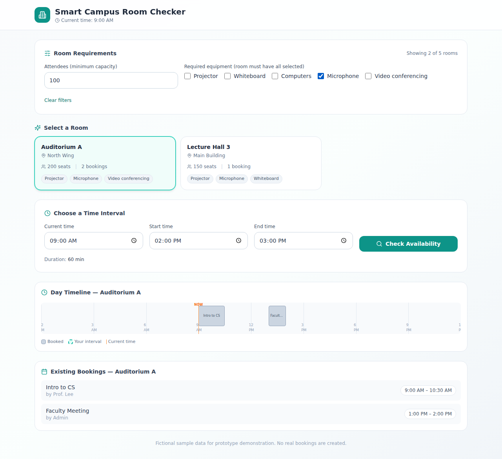
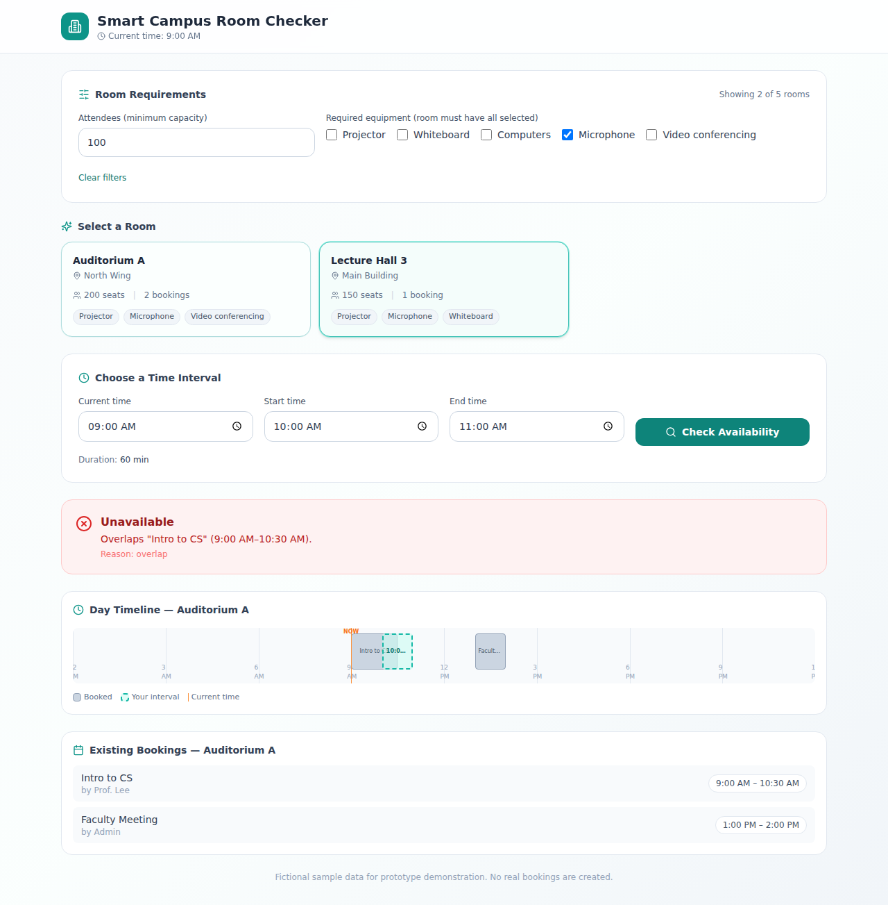
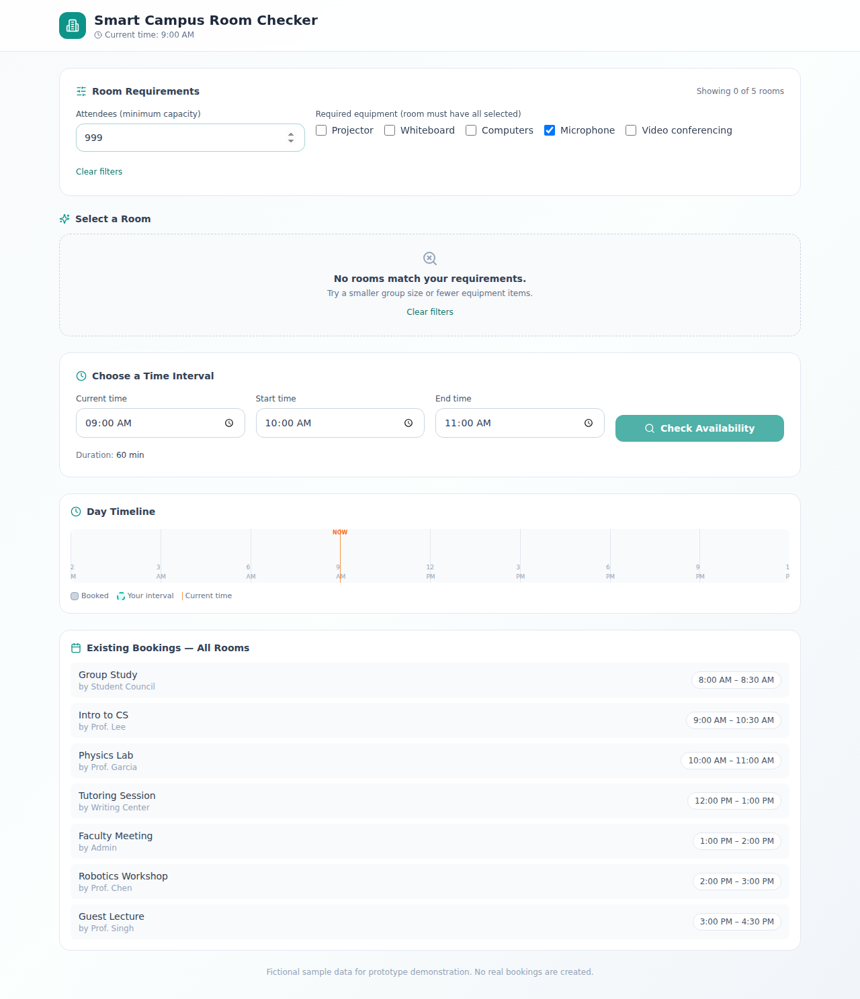
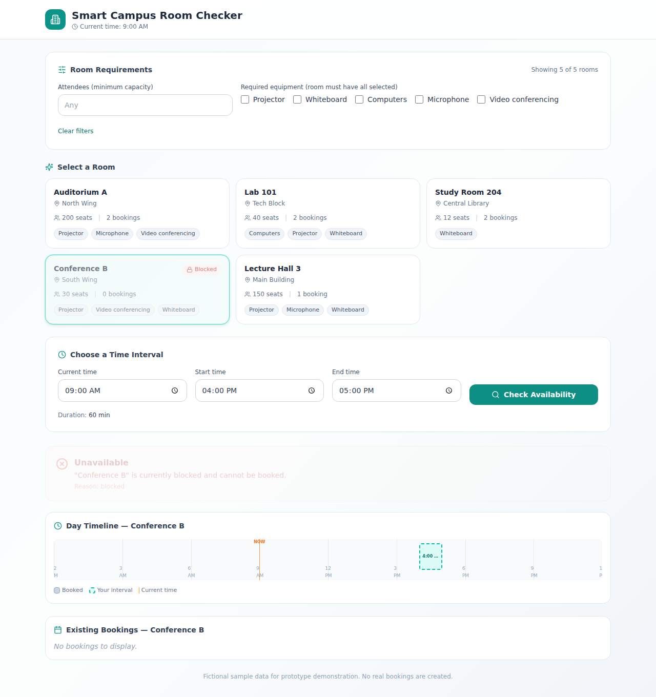
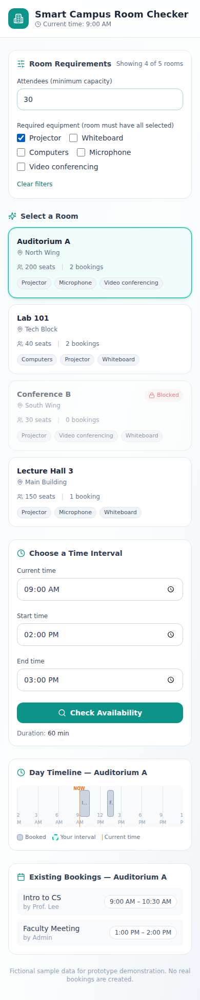
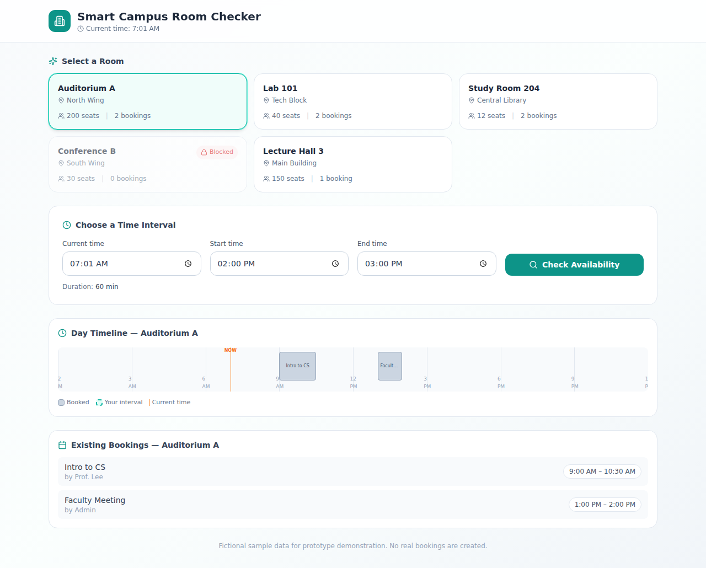
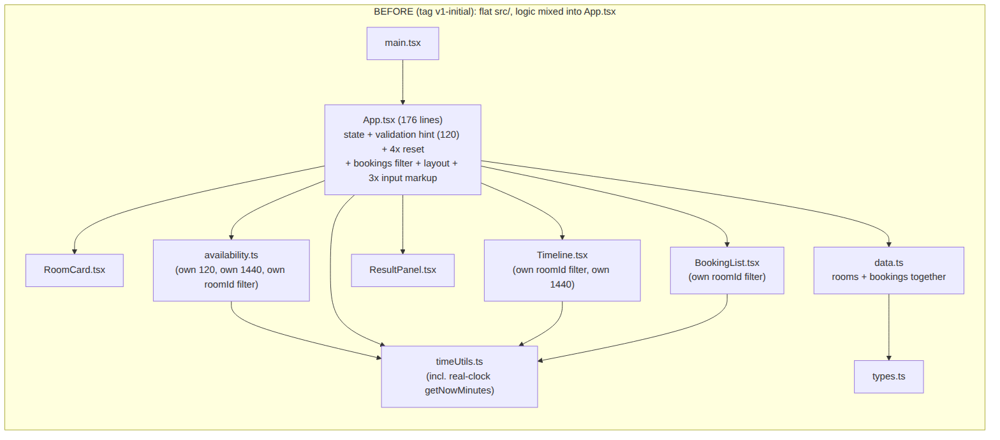
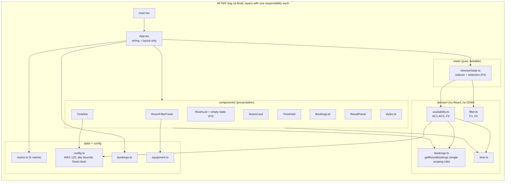

# Assignment #04 — AI-assisted evolution, refactoring and quality evaluation

Project: Smart Campus Room Availability Checker · Student: Serikova Shugyla · AI assistant: **Claude (Anthropic)** · Dates: 2–3 November 2026
Repository: https://github.com/Serikova-Shugyla/Software_Engineering_2026 · Versions: tag `v1-initial` (before), tag `v2-final` (after)

Evidence files are in `report/evidence/`; screenshots in `report/screenshots/`; diagrams in `report/diagrams/`. How to run everything: see `README.md`.

---

## Task 1 — Codebase analysis

### 1.1 Context given to the AI (repository map of `v1-initial`)

| File | Responsibility (before) |
|---|---|
| `src/App.tsx` (176 lines) | state, derived values, validation hint, event handlers, layout, 3 copies of the time input |
| `src/availability.ts` (71) | `checkAvailability(start, end, room, bookings, now)` — AC1–AC5 |
| `src/timeUtils.ts` (24) | time formatting/parsing, `getNowMinutes()` (real clock) |
| `src/data.ts` (19) | 5 rooms + 7 bookings together |
| `src/types.ts` (16) | `Room` (id, name, building, capacity, blocked), `Booking` |
| `src/components/*` | RoomCard, Timeline, BookingList, ResultPanel |
| 2 test files | 48 tests (19 + 29), all passing — real baseline run, `report/baseline-test-output.txt` |

Constraints given: AC1–AC6, F1–F5, no login/payments/live API/database, keep the existing `checkAvailability` signature.

### 1.2 Maintainability risks (verified against the code, not taken on trust)

| # | Risk | Evidence in `v1-initial` |
|---|---|---|
| R1 | **Same business rule written twice** (max duration) — if one copy changes, UI hint and validator disagree | `src/availability.ts:33` (`end - start > 120`) and `src/App.tsx:144` (`endMin - startMin > 120`) |
| R2 | **"Which bookings belong to this room" is re-implemented in four places** — with several rooms, one wrong copy would check another room's data (breaks F5) | `availability.ts:52`, `App.tsx:30`, `components/BookingList.tsx:12`, `components/Timeline.tsx:20` |
| R3 | **`App.tsx` mixes state, rules and layout**; the "clear previous result" rule is pasted 4 times and the input styling 3 times | `App.tsx:45, 104, 115, 126` (`setHasChecked(false)`), `App.tsx:105, 116, 127` (identical class string) |
| R4 | **Non-deterministic "current time"**: default comes from the real clock although the assignment requires a fixed time | `timeUtils.ts:21` `getNowMinutes()`, used at `App.tsx:16` |
| R5 | **Day bounds duplicated; import placed at the bottom of the file** (circular-import workaround) | `availability.ts:18` and `Timeline.tsx:14` (`1440`); `availability.ts:71` |
| R6 | No place for the new data: `Room` has no equipment, rooms and bookings share one file, flat `src/` folder with no layers | `types.ts`, `data.ts` |

### 1.3 Prioritized improvement plan (written before editing code)

1. **P1** — move constants to one `config.ts`; make `domain/` pure (R1, R5). Re-run the 48 tests.
2. **P2** — one `getRoomBookings()` used everywhere (R2). Re-run tests.
3. **P3** — extend the model (equipment) and add the 5-room catalog + `filterRooms` (F1, F2, F4).
4. **P4** — move UI behaviour into a pure reducer; split components (R3); F5 as a derived result.
5. **P5** — fixed clock (R4); write new tests; measure before/after.

### 1.4 One AI suggestion rejected / modified

Claude's first guide suggested a JavaScript layout (`rooms.js`, `checkAvailability(room, start, end, nowMin)`, string times like `"10:00"`). I **rejected the signature**: the real code is TypeScript with minutes-from-midnight and `checkAvailability(start, end, room, bookings, now)`, and 48 passing tests depend on it. Keeping it meant the regression suite could be reused unchanged (only import paths and one fixture line changed — see 4.4). I also replaced a suggested jsdom-based UI test with `react-dom/server` markup tests, because no new dependency could be installed and verified in the AI environment.

---

## Task 2 — Feature extension: room catalog and filters

**Catalog** (`src/data/rooms.ts`, fictional; each room has id, name, capacity, equipment list, blocked flag; its bookings are the `data/bookings.ts` rows with the same `roomId`):

| id | Room | Capacity | Equipment | Blocked | Bookings |
|---|---|---|---|---|---|
| r1 | Auditorium A | 200 | projector, microphone, video-conferencing | no | 2 |
| r2 | Lab 101 | 40 | computers, projector, whiteboard | no | 2 |
| r3 | Study Room 204 | 12 | whiteboard | no | 2 |
| r4 | Conference B | 30 | projector, video-conferencing, whiteboard | **yes** | 0 |
| r5 | Lecture Hall 3 | 150 | projector, microphone, whiteboard | no | 1 |

**Rules:** F1 capacity ≥ attendees · F2 room has *all* selected equipment · F3 blocked room is never Available · F4 clear empty state · F5 room switch refreshes the result. Original AC1–AC6 logic is unchanged (same function, same messages).

**Demonstration** (real browser run of the built app, Chromium via Playwright; screenshots in `report/screenshots/`):

| Scenario | What was done | Observed result | Screenshot |
|---|---|---|---|
| Successful filtering | attendees = 100 + Microphone | "Showing 2 of 5 rooms" (Auditorium A, Lecture Hall 3) | `02-filter-success.png` |
| Availability check | select Lecture Hall 3, 10:00–11:00, Check | **Available** — "Lecture Hall 3 is available for 10:00 AM–11:00 AM." | `03-check-available.png` |
| Room switching (F5) | then click Auditorium A (no new Check) | result refreshed: **Unavailable** — overlaps "Intro to CS" (9:00 AM–10:30 AM) | `04-room-switch-refresh.png` |
| Unsuccessful filtering (F4) | attendees = 999 | empty state "No rooms match your requirements." | `05-empty-state.png` |
| Blocked room (F3) | Conference B, 16:00–17:00 | **Unavailable** — blocked | `06-blocked-room.png` |
| Capacity boundary | 40 attendees + Computers → Lab 101 shown; 41 → empty state | as expected | (script output) |
| Mobile | 390 px wide, attendees 30 + Projector | no horizontal scroll (scrollWidth 390) | `07-mobile-filter.png` |

The app was bundled from the real sources with esbuild + Tailwind for these screenshots (the Windows Vite binaries cannot run in the AI sandbox); no console or page errors were reported. Please also confirm visually with `npm run dev`.

| Filter (F1+F2) and room list | Room switch refreshes result (F5) |
|---|---|
|  |  |

| Empty state (F4) | Blocked room (F3) | Mobile (390 px) |
|---|---|---|
|  |  |  |

Before (v1-initial, no filters): 

---

## Task 3 — Refactoring

**Diagrams:** `report/diagrams/before.png` and `report/diagrams/after.png` (Mermaid sources `before.mmd`, `after.mmd`).





**What changed:** flat `src/` → `config` / `data` / `domain` (pure logic) / `state` (reducer) / `components` (presentation). `App.tsx` now only wires state to components.

**Behavior preserved:** step A (pure refactor, before any feature) re-ran all 48 original tests: 48/48 passed (`evidence/ai-sandbox-step-A-pure-refactor.txt`). The two original test files were only *moved* to `src/domain/`; their diff is: the import path `./types` → `../types`, and one fixture line `equipment: [],` added because `Room` gained a required field. **No assertion was changed.**

**Design decisions (with justification):**

1. **Pure `domain/` layer with no React or DOM.** Availability and filter rules are plain functions, so they run in a Node test without a browser. *Alternative rejected:* keeping the rules inside components, which is what made v1 hard to test and caused R1/R2.
2. **Single owner for each rule** (`getRoomBookings`, `MAX_BOOKING_MINUTES`/`exceedsMaxDuration`, `clearResult`, `INPUT_CLASS`). Changing a rule means editing one place; the measures in Task 5 show 10 redundant copies disappeared.
3. **UI behaviour as a reducer + selectors, with the result *derived* rather than stored.** F5 then holds by construction: the result is recomputed from (selected room, times), so a stale result from another room cannot be shown. Because the reducer is pure, the whole filter → select → check → switch flow is testable (I1–I5, S1–S6).
4. **Blocked rooms stay visible but can never be Available.** Hiding them would silently contradict "display only rooms that satisfy the user's requirements" (blocked is not a requirement), while F3 is enforced in the availability rule.

---

## Task 4 — Automated testing

**Commands (actual):**

```
npm test                  # = vitest run  → all 6 test files
npm run typecheck         # tsc --noEmit -p tsconfig.app.json   (passed in AI sandbox)
npm run lint              # eslint        (passed in AI sandbox)
```

**Results**

| Run | Where / by whom | Result |
|---|---|---|
| Baseline `v1-initial` | student's machine, real Vitest 3.2.7 | **48 passed / 48** (`report/baseline-test-output.txt`) |
| After pure refactor (step A) | AI sandbox, stand-in runner | 48 / 48 (`evidence/ai-sandbox-step-A-pure-refactor.txt`) |
| Final `v2-final` | AI sandbox, stand-in runner (pre-check) | **79 passed / 79** (`evidence/ai-sandbox-test-run.txt`) |
| Final `v2-final` | **student's machine, real Vitest** | **see `report/final-test-output.txt`** (official evidence) |

*Honesty note:* the AI sandbox only has Windows binaries of Vite/Vitest, so Claude ran the unchanged test files through a minimal vitest-compatible runner (same `describe/it/expect`). It reproduced the student's real baseline exactly (19 + 29 = 48), which is why it is a trustworthy pre-check, but only the student's own `npm test` output counts as final proof.

### 4.1 Test inventory (79 tests in 6 files)

| File | Tests | Covers |
|---|---|---|
| `domain/availability.test.ts` | 19 | AC1–AC5 regression (original) |
| `domain/availability.improved.test.ts` | 29 | AC1–AC6 regression with extra boundaries (original) |
| `domain/filter.test.ts` | 13 | catalog sanity, F1, F2, F3, F4, F5 (data level), `parseAttendees` |
| `domain/bookings.test.ts` | 2 | room scoping, non-mutating sort |
| `state/checkerState.test.ts` | 11 | **integration**: filter → select → check → switch room; F1/F2/F4/F5 flows |
| `components/ui.test.tsx` | 5 | **UI behavior**: empty state, filtered list, blocked badge, filter panel, result panel |

New tests: **31** (≥ 10 required). Original regression: **48**.

### 4.2 Required boundaries

| Boundary | Test(s) |
|---|---|
| exactly 120 vs 121 minutes | T06 (120 → accepted), T07 (121 → `too_long`) |
| touching vs overlapping intervals | T01, T08 (touching → accepted), T09–T12, R9 (overlap → rejected), F5a (touch on real data) |
| exact capacity vs insufficient capacity | F1a (40 = 40 → shown), F1b (41 > 40 → hidden), F1c |
| AC5 non-mutation | AC5 group, R6, R11, B2, S6 |
| ≥ 1 integration / UI check | I1–I5, S1–S6 (integration); U1–U5 (UI) |

### 4.3 Do the tests detect real bugs? (mutation check)

Nine deliberate bugs were injected one at a time into a copy of the code; **every one was caught** (`evidence/ai-sandbox-mutation-results.txt`):

| Injected bug | Tests failing |
|---|---|
| F1 `>=` → `>` | 3 |
| F2 `every` → `some` | 8 |
| room-scoping filter removed | 6 |
| AC2 `>` → `>=` (120 becomes invalid) | 4 |
| AC4 overlap `<` → `<=` (touching becomes conflict) | 8 |
| F5: selecting a room clears the result | 1 |
| F3 blocked check removed | 5 |
| F4 empty-state text changed | 1 |
| AC5 sort in place (the old BUG-B) | 1 |

Weak spots: F5, F4 text and in-place sort are each protected by a single test.

### 4.4 Diff of the two original test files vs `v1-initial`
Import path `./types` → `../types` and `equipment: [],` added to the fixture room. Nothing else.

---

## Task 5 — Quality evaluation (evidence, nothing invented)

| Measure | Original (`v1-initial`) | Final (`v2-final`) | How obtained |
|---|---|---|---|
| Automated tests passed / total | **48 / 48** | **79 / 79** (confirm with your `final-test-output.txt`) | `npm test`; baseline from the real file `report/baseline-test-output.txt`; final from the AI pre-check, to be confirmed |
| Duplicated logic locations removed | — | **10 redundant copies removed** (details below) | `node scripts/measure.mjs` → `git grep` on the tag vs the working tree, non-test files only (`evidence/measure-output.txt`) |
| Source files / folders | 10 files, 2 folders | 20 files, 5 folders | same script, counts non-test `.ts/.tsx` |
| Source lines | 558 | 882 | same script (grew because of the new feature set) |
| Largest file | `App.tsx` 176 lines (state + rules + layout) | `App.tsx` 158 lines (wiring + layout only); largest logic file `checkerState.ts` 106 | same script |
| Test files | 2 | 6 | same script |
| Lint / typecheck | — | both clean (AI sandbox run) | `npm run lint`, `npm run typecheck` |

**Duplicated logic detail** (copies before → after, each rule has exactly one owner after):

| Rule | Before | After | Removed |
|---|---|---|---|
| Max-duration literal `120` in code | 2 (`App.tsx:144`, `availability.ts:33`) | 1 (`config.ts`) | 1 |
| Day-bound literal `1440` | 2 (`availability.ts:18`, `Timeline.tsx:14`) | 1 (`config.ts`) | 1 |
| "Bookings of a room" filter | 4 | 1 (`domain/bookings.ts`) | 3 |
| "Invalidate previous result" | 4 (`App.tsx:45,104,115,126`) | 1 (`clearResult`) | 3 |
| Copy-pasted input class string | 3 | 1 (`components/styles.ts`) | 2 |
| **Total** | | | **10** |

The metric counts *redundant copies of one rule* found by the listed regular expressions; it is a proxy, not a full clone-detection tool, and the patterns are in `scripts/measure.mjs`.

**Code structure — responsibilities after refactoring**

| Module | Responsibility |
|---|---|
| `config.ts` | business constants and the fixed clock |
| `data/*` | fictional rooms, bookings, equipment labels |
| `domain/availability.ts` | AC1–AC5, F3 (pure) |
| `domain/filter.ts` | F1, F2, attendee parsing (pure) |
| `domain/bookings.ts` | the only room-scoping rule, non-mutating sort |
| `state/checkerState.ts` | reducer + selectors: filters, selection, F5 |
| `components/*` | rendering only |
| `App.tsx` | connects state to components |

**Remaining limitations**
1. Data is in memory; the tool only *checks*, it does not create bookings.
2. Time-of-day only — no dates.
3. UI tests inspect rendered markup; no real click-through browser test runner (reducer tests cover the logic).
4. Timeline axis shows 24:00 as "12 PM" (existing cosmetic issue, unchanged to keep behavior identical).
5. Unused `@supabase/supabase-js` dependency remains in `package.json` (not imported anywhere); it was left because the lockfile cannot be regenerated offline.
6. Source lines increased (558 → 882): the new feature set cost code; the gain is structure, not size.

---

## Task 6 — AI reflection

<!-- STUDENT: before submitting, make sure every statement under "Verified by me" is true for you (you run npm test and npm run dev yourself). Edit if needed. Word count must stay 200–300. -->

**Context.** I gave Claude the assignment PDFs and my zipped project (git history, the `v1-initial` tag and the baseline output of 48 passing tests), plus the constraints: no login, payments, API or database, and AC1–AC6 must keep working. Claude worked in small steps: it refactored first, reran the 48 existing tests, and only then added the catalog and filters.

**Useful.** Claude found the duplicated rules by reading the code: the 120-minute limit in `App.tsx` and `availability.ts`, the room filter in four files, and the reset logic repeated four times. Its idea of moving click behaviour into a pure reducer made the F5 room-switch rule testable without a browser.

**Incorrect or modified.** Claude's first guide proposed a JavaScript layout with a `checkAvailability(room, start, end, now)` signature and string times. That did not match my TypeScript code, so I kept the real signature and all 48 existing tests. A jsdom UI test was replaced by rendered-markup tests because nothing new could be installed.

**Verified by me.** I cloned the repository, created the `v1-initial` tag and ran the baseline tests myself. For the final version I ran `npm test` and `npm run dev` on my own machine and compared them with the report instead of trusting Claude's sandbox run, which used a stand-in runner and counts only as a pre-check.

**Tests and decisions.** Tests drove the order of work: the 48 old tests had to stay green after every refactoring step. Nine deliberately injected bugs were all detected, but F5, the empty-state text and in-place sorting are each guarded by only one test, so I would add a second test for each.

**Next.** Browser-level interaction tests, creating bookings, and multi-day dates.

---

*AI-use record, selected prompts, decisions and verification sources: `report/AI_APPENDIX.md`.*
