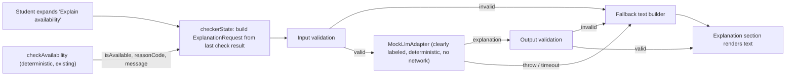

# Feature Specification — "Explain availability" (Practice #11, Task #02)

Status: **Specification only — not implemented.** No source file was modified for this task.

## 1. User story

> As a student, I want a short explanation of room availability so I understand the decision.

The feature adds an **optional, clearly separated explanation section** below the existing
result panel. The existing availability decision, its message texts, and all booking rules
are untouched. The deterministic availability checker remains the **only source of truth**:
the LLM only rewords an already-computed decision, it never decides.

## 2. Input / output contract

### Input: `ExplanationRequest`

| Field | Type | Constraints |
|---|---|---|
| `roomLabel` | `string` | non-empty, trimmed, ≤ 80 chars (the room's display name) |
| `startTime` | `number` | integer minutes since 00:00, `0 ≤ startTime < endTime ≤ 1440` |
| `endTime` | `number` | integer minutes since 00:00, same bounds |
| `isAvailable` | `boolean` | must equal the checker's verdict for this exact input |
| `reasonCode` | `string` | one of the existing checker reasons: `"invalid"`, `"range"`, `"order"`, `"past"`, `"too_long"`, `"blocked"`, `"overlap"`, or `"available"` when `isAvailable` is `true` |

### Output: `ExplanationResult`

| Field | Type | Constraints |
|---|---|---|
| `explanation` | `string` | one or two short sentences, ≤ 280 chars, in the app's language |
| `source` | `"mock-llm" \| "fallback"` | which path produced the text (transparency for graders/users) |

The output never includes a different availability verdict. If the generated text would
contradict `isAvailable`, the fallback text is used instead.

## 3. Acceptance criteria for the AI feature

| ID | Criterion |
|---|---|
| **AC-E1** | The explanation section appears **only after a check** and only when the user expands it (optional; collapsed or hidden by default). No explanation is shown before the first check. |
| **AC-E2** | The explanation always **agrees with the checker**: it states available/unavailable exactly as `isAvailable` and names the reason matching `reasonCode`. It never invents bookings, rooms, or times that are not in the request. |
| **AC-E3** | With the **mock LLM adapter**, the explanation is produced deterministically from the contract fields alone — no network, no API key, same input → same output. |
| **AC-E4** | On timeout, adapter failure, or missing key, the section shows a **safe generic fallback** derived from the contract fields (see §5), clearly marked as generic. The UI never shows a raw error message or stack trace. |
| **AC-E5** | The feature causes **no side effects**: no mutation of rooms/bookings, no change to `checkAvailability` results, message texts, or any existing test. Existing suite must stay green (95/95 today) plus new focused tests. |

## 4. Input and output validation

**Input validation (before the adapter is called):**
- `roomLabel` trimmed and non-empty; longer input truncated to 80 chars.
- `startTime`/`endTime` must be finite numbers within `0..1440` with `startTime < endTime`.
- `reasonCode` must be in the allowed set and consistent with `isAvailable`
  (`"available"` ⇔ `isAvailable === true`).
- Any invalid request **never reaches the adapter**; the section shows the fallback text
  with `source: "fallback"`.

**Output validation (after the adapter returns):**
- `explanation` must be a non-empty string ≤ 280 chars; longer text is truncated at a
  sentence boundary.
- The text must not contain the opposite verdict word (e.g. must not say "unavailable"
  when `isAvailable` is `true`); on violation → fallback.
- The adapter's response is treated as untrusted data and rendered as **plain text only**
  (no HTML injection; the app already renders text nodes, this stays that way).

## 5. Safe fallback behavior

| Situation | Behavior |
|---|---|
| **Timeout** (adapter does not respond within ~1.5 s in the real adapter; mock responds instantly) | Show fallback: `Explanation is not available right now. The check itself is reliable: <verdict sentence from the checker message>.` with `source: "fallback"`. |
| **API failure** (adapter throws / non-OK response / malformed output) | Same fallback as timeout. The failure is logged to the console for diagnostics, not shown to the user. |
| **API key unavailable / feature off** | The adapter is simply not invoked. The mock adapter (default in this prototype) requires no key at all; a future real adapter without a configured key returns the fallback immediately. |

The fallback text is built **purely from the validated contract fields**, so it is always
correct even when the LLM path is dead. The availability decision shown above the section
is never affected by any of these failures.

## 6. Architecture diagram

Key property: `checkAvailability` feeds the explanation feature, but the explanation
feature has **no path back** into the checker, the reducer's verdict, or the result panel.

## 7. Mock LLM adapter

- Name exported as-is, e.g. `mockLlmAdapter`, and labeled in code and UI ("AI explanation — mock").
- Pure function `(req: ExplanationRequest) => ExplanationResult` with `source: "mock-llm"`.
- Deterministic template logic (no randomness, no network): e.g. for `reasonCode: "overlap"`,
  "Lab 101 is unavailable from 10:00 AM to 11:00 AM because another booking overlaps this time."
- Lives in its own small module (adapter file + contract types), so the future real adapter
  is a drop-in swap without touching the UI — this is the one justified pattern boundary
  (single data shape, AGENTS.md allows ≤ 2 patterns).

## 8. What will NOT change (implementation phase)

- `checkAvailability` signature, logic, order of checks, all message texts (`messages.ts`).
- Existing fixtures, config constants (120 min, 00:00–24:00, 09:00 fixed clock).
- The result panel's current texts and behavior; the 24:00 "12 PM" timeline label stays as-is.
- The unused `@supabase/supabase-js` dependency stays (no uninstall, per minimal-change rule).
- All 95 existing tests stay untouched and green; new tests cover the contract, validation,
  mock adapter, and fallback paths only.

## 9. Planned files (for the later implementation task)

- `src/domain/explain/types.ts` — contract types.
- `src/domain/explain/mockLlmAdapter.ts` — labeled mock adapter.
- `src/domain/explain/explain.ts` — validation + fallback orchestration (pure).
- `src/components/ExplanationSection.tsx` — optional collapsible UI section.
- `src/domain/explain/*.test.ts` — focused regression tests.
